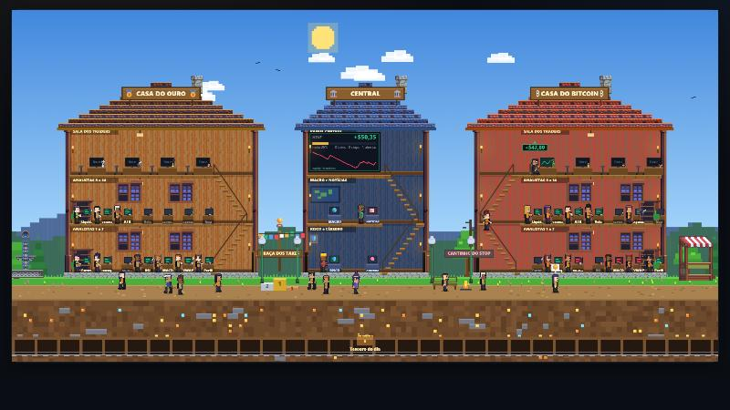

# Kairos: robô de ouro e bitcoin para o MetaTrader 5, com painel em forma de vila

> *Kairos* (do grego): o momento oportuno.



O **Kairos** é um robô de trading (Expert Advisor em **MQL5**) que lê o gráfico, junta vários indicadores num placar de confluência, passa por uma **verificação em duas etapas** e só então entra. Ele opera **ouro (`XAUUSDm`)** e **bitcoin (`BTCUSDm`)** na corretora Exness. Cada decisão, aceita ou recusada, vem com a explicação do motivo.

Junto vem um **painel web local** (Python puro, sem dependências) que mostra tudo o que o robô está fazendo. A tela inicial é uma **vila em pixel art**: cada indicador é um morador que trabalha na casa do ativo, e clicar nele abre o relatório do que ele está analisando.

## Destaques de engenharia

- **Pipeline de dados ponta a ponta:** robô (MQL5) → arquivos JSON/CSV por ativo → API local em Python (`http.server`, sem dependências) → painel web, com leitura atômica, reconciliação do histórico da conta com o diário e dia de negócio fixo em UTC-3.
- **Validação estatística, não achismo:** cada mudança foi testada no Testador do MT5 com dezenas de milhares de sinais, reportando média por operação com **margem de erro (±)**, separação de períodos e controle ao acaso; ideias que não se sustentaram foram descartadas e documentadas.
- **Aprendizado sem overfitting:** autópsia automática de cada trade (MAE/MFE, pontos fracos na entrada, hipótese do resultado) e estatística por fator **só com amostra mínima**; modelo (regressão logística) avaliado só no futuro, semestre a semestre, e só liberado para influenciar o robô com critério objetivo (AUC).
- **Segurança por padrão:** trava de conta real, queda máxima, sem martingale, sem hedge, comandos do painel por arquivo com id crescente (anti-replay) e servidor só em localhost.
- **Automação de testes:** orquestração do Testador por linha de comando, matrizes de comparação reprodutíveis e guarda que impede o Testador de ligar o robô ao vivo.
- **Front-end sem biblioteca:** a vila é canvas 2D puro (cenário pré-renderizado em cache, sprites 1:1, dia e noite), lendo só a API local.

> ## ⚠️ Leia antes de qualquer coisa
> - **É um projeto de estudo e portfólio, desenvolvido com apoio do Claude Code (IA).** Eu (Guilherme) defini o que construir, revisei, testei e tomei as decisões; a maior parte do código foi escrita em parceria com a IA.
> - **Não é recomendação de investimento** e **não há prova de que o robô tenha vantagem estatística**. Os testes mostram resultado médio por operação perto de zero (detalhes em [Resultados e limites honestos](#resultados-e-limites-honestos)).
> - **Use só em conta DEMO.** O robô se recusa a iniciar em conta real, a menos que você marque de propósito `InpAllowRealAccount`. Não faça isso.
> - Operar CFDs de ouro e criptomoedas envolve risco alto de perda.

---

## Sumário
1. [O que o projeto faz](#o-que-o-projeto-faz)
2. [Arquitetura](#arquitetura)
3. [Como o robô decide](#como-o-robô-decide)
4. [Gestão de risco e travas](#gestão-de-risco-e-travas)
5. [O painel e a vila](#o-painel-e-a-vila)
6. [Instalação e uso](#instalação-e-uso)
7. [Parâmetros do robô](#parâmetros-do-robô)
8. [Testes, aprendizado e cérebro](#testes-aprendizado-e-cérebro)
9. [Resultados e limites honestos](#resultados-e-limites-honestos)
10. [Estrutura de pastas](#estrutura-de-pastas)
11. [Dados incluídos neste repositório](#dados-incluídos-neste-repositório)
12. [Créditos e licenças](#créditos-e-licenças)

---

## O que o projeto faz

- **Lê o gráfico** como um analista: estrutura de mercado (topos e fundos), zonas de suporte e resistência, e três tipos de setup: **rompimento**, **rejeição** em zona e **pullback**.
- **Pontua por confluência:** 14 indicadores votam (a favor, contra ou neutro). O robô só segue se uma porcentagem mínima dos que têm opinião concorda (padrão 75%). Nenhum indicador sozinho decide.
- **Verifica em duas etapas:** a etapa 1 analisa o sinal; a etapa 2 espera o sinal se sustentar por 30 segundos no preço de mercado, sem o preço ter fugido, sem o stop ter sido violado e com a relação retorno/risco ainda boa.
- **Gerencia o risco:** risco fixo por operação, tamanho de lote calculado pelo stop, limite de posições abertas, travas diárias e de queda máxima, bloqueio em notícia forte.
- **Explica tudo:** diário com cada decisão, autópsia de cada trade (o que ficou fraco na entrada, o que aconteceu depois), notas automáticas e gráfico por operação.
- **Mostra num painel:** resultado do dia, meta, posições abertas, notícias, risco, validação e a vila.

## Arquitetura

```
┌────────────────────────── MetaTrader 5 ──────────────────────────┐
│  Kairos.mq5 (um robô por gráfico: XAUUSDm e BTCUSDm)             │
│   lê o gráfico → placar → verificação 2 etapas → ordem/gestão    │
│   escreve em MQL5\Files:  Kairos_<ativo>_status.json             │
│                           Kairos_<ativo>_journal (decisões)      │
│                           Kairos_<ativo>_sentiment, bars_*       │
│   lê comandos do painel:  Kairos_<ativo>_cmd (pausar, fechar...) │
└─────────────────────────────┬────────────────────────────────────┘
                              │ arquivos (nada de rede entre os dois)
┌─────────────────────────────▼────────────────────────────────────┐
│  server.py (http.server, só Python padrão) → http://localhost:8000│
│   robot.py (lê os arquivos) · diario.py · learning.py            │
│   validacao.py · news.py/news_btc.py · tradechart.py             │
│   robo.html + vila.js (painel e vila em canvas 2D)               │
└──────────────────────────────────────────────────────────────────┘
```

- O robô e o painel **se comunicam por arquivos** na pasta `MQL5\Files` do terminal. O painel só envia comandos quando você clica nos botões do topo (pausar, fechar tudo, desligar, trocar meta do dia).
- Um robô por gráfico, cada um com os próprios arquivos, o que permite ouro e bitcoin ao mesmo tempo com o mesmo número mágico.
- O ouro (CFD) não negocia no fim de semana; o bitcoin é tratado como 24/7 (o robô detecta pela sessão de negociação do símbolo).

## Como o robô decide

**Etapa 1: análise (a cada candle fechado ou em tempo real).** Aprova só se tudo passar:

| Grupo | O que confere |
|---|---|
| **Placar de confluência** (14 indicadores) | estrutura a favor, hierarquia forte, médias móveis 21/50, RSI 14, MACD 12/26/9, VWAP do dia, perfil de volume, liquidez varrida, volume acima da média, volatilidade (ATR), padrão de vela, sentimento das manchetes, surpresa da agenda econômica, gap não preenchido |
| **Hierarquia de Dow** | tendência mensal, semanal e diária; é só mais um voto, não uma regra obrigatória (configurável) |
| **Contexto e custo** | relação retorno/risco mínima, caminho livre até 1,5R, horário, spread e custo em relação ao risco |
| **Notícias** | calendário econômico do próprio MT5 (bloqueia antes e depois de dado de alto impacto) e sentimento das manchetes (CoinDesk, Decrypt e Google Notícias para o bitcoin) |
| **Travas** | limites do dia, pausa depois de stop, freio de desempenho, sem posição contrária no mesmo ativo, meta do dia |

**Etapa 2: verificação ao vivo (30 s).** Não persegue o preço (limite de 0,5 ATR desde o sinal), o stop não pode ter sido violado, a relação retorno/risco ao vivo continua boa, o nível estrutural se mantém e o spread segue aceitável.

**Saída:** modelo fixo de **1:3** (arrisca 1 para ganhar 3, `InpFixedRR`) ou alvo pela próxima zona. Opcionais: levar o stop para a entrada depois de N×R a favor (`InpBreakevenR`) e **saída por tempo** (`InpMaxHoldHours`, desligada por padrão porque piorou o bitcoin nos testes).

## Gestão de risco e travas

- Risco por operação: **0,5% do saldo** (`InpRiskPct`); lote calculado pela distância do stop. Se o lote mínimo arrisca mais que 2× o planejado, **não opera**.
- Até **4 posições** abertas por ativo na demo (3 por padrão), com risco total aberto limitado.
- **Queda máxima de 10%** desde o pico desliga o robô até você liberar. Perda máxima diária e perdas seguidas existem, mas ficam relaxadas na demo (`InpDemoRelaxLocks`) para acumular amostra.
- Meta de ganho do dia em US$ (pode trocar pelo painel): ao bater, só para de abrir ou fecha tudo e para até o dia seguinte.
- **Sem martingale**, sem aumentar lote depois de perda, sem posição contrária (hedge).
- O **dia vira à 00:00 de Brasília** (UTC-3 fixo) no painel, nos relatórios e no robô, qualquer que seja o fuso do computador.
- Trava de conta real: sem `InpAllowRealAccount = true` o robô nem inicia em conta real.

## O painel e a vila

Abra `http://localhost:8000`. O menu (☰ no canto) leva às abas: **Vila**, Hoje, Diário, Decisões, Validação, Operações, Gráficos, Notícias, Atividade e Configuração.

### A Vila (tela inicial)

Inspirada em jogos de pixel art vistos de lado, é só uma forma divertida de enxergar os mesmos dados:

- **Casa do Ouro** e **Casa do Bitcoin**: três andares cada. Nos dois de baixo, um analista por indicador (a tela do posto fica **verde** se concorda, **vermelha** se discorda, **cinza** sem opinião). No de cima, a sala dos traders: um trader por **posição aberta**, com o resultado flutuante acima da cabeça.
- **Casa Central**: Macro, Notícias, Risco e Cérebro, mais o telão com o resultado de hoje, a meta e a curva de patrimônio.
- **Rotina dos moradores:** analista com opinião fica trabalhando; se o indicador fica **neutro** (ou o mercado fecha) ele levanta, desce a escada e **passeia pela vila**, voltando quando tiver opinião de novo.
- **Quem fechou operação hoje também passeia:** os **takes** na *Praça dos Takes* (os 3 maiores sobem no pódio, de coroa) e os **stops** no *Cantinho do Stop* (nuvem de chuva, banco e fogueira).
- **Clique em qualquer morador** e abre o **relatório**: o que o indicador mede (em português simples), a opinião atual e o detalhe, o sinal analisado, todos os votos; para o trader, entrada, stop, alvo e quanto do caminho até o alvo já foi percorrido; para um take ou stop, por que entrou e o que aconteceu.
- Céu e luz seguem a hora de Brasília; zoom com os botões ou Ctrl + roda; Esc fecha o relatório.

A vila só lê os dados do robô, não envia ordens.

### API local
`/api/robots`, `/api/robot?sym=...`, `/api/robot/diary`, `/api/robot/validation`, `/api/robot/learning`, `/api/news`, `/api/robot/trades.csv`.

## Instalação e uso

**Requisitos:** Windows, MetaTrader 5 da Exness com **conta demo**, Python 3.10+ (sem pacotes extras para o painel).

1. **Instale o robô.** Copie a pasta `mt5/Kairos/` para `MQL5\Experts\Kairos\` do seu terminal (MT5: *Arquivo → Abrir pasta de dados*), abra `Kairos.mq5` no MetaEditor e compile (F7).
2. **Anexe aos gráficos.** Abra `XAUUSDm` e `BTCUSDm` (usei **H1** nos dois), arraste o Kairos para cada gráfico e ligue o botão **Algo Trading**.
3. **Ajuste os caminhos locais.** Alguns arquivos têm o caminho do MT5 de quem escreveu; troque `SEU_USUARIO` e `ID_DO_TERMINAL` pelos do seu computador (ou defina a variável de ambiente `XAUR_FILES` com a pasta `MQL5\Files` para o painel). Arquivos: `robot.py`, `learning.py` (nota por trade num cofre Obsidian, opcional) e os scripts de `mt5/`.
4. **Ligue o painel:** duplo clique em `Abrir_Kairos.bat` (ou `python server.py`) e abra `http://localhost:8000`.
5. Confira se a faixa do topo diz **DEMO** e se o robô aparece como ativo.

## Parâmetros do robô

Os principais (todos em `mt5/Kairos/XR_Inputs.mqh`, com comentário em português):

| Parâmetro | Padrão | Para quê |
|---|---|---|
| `InpAllowRealAccount` | `false` | trava de segurança de conta real |
| `InpRiskPct` | 0,5 | % do saldo arriscado por operação |
| `InpMaxDrawdownPct` | 10 | queda máxima desde o pico; desliga o robô |
| `InpMaxPositions` | 3 | posições abertas ao mesmo tempo |
| `InpMaxTotalRiskPct` | 1,5 | risco total aberto aceito |
| `InpRRMode` / `InpFixedRR` | 1 / 3,0 | saída 1:3 ou pela estrutura |
| `InpEvalMode` | 0 | 0 = candle fechado (o modo testado), 1 = tempo real |
| `InpTwoStep` / `InpVerifySecs` | `true` / 30 | verificação em duas etapas |
| `InpUseConfluence` / `InpMinConfluence` | `true` / 75 | placar por confluência e porcentagem mínima |
| `InpMinConfluenceGold` | 0 | confluência mínima só do ouro (ex.: 90 melhorou o ouro em H1 nos testes) |
| `InpMaxHoldHours` | 0 | saída por tempo (desligada) |
| `InpBreakevenR` | 0 | stop na entrada depois de N×R a favor |
| `InpDailyTargetUSD` | 0 | meta de ganho do dia (também pelo painel) |
| `InpBrainMode` | 1 | 0 desliga; 1 só informa; 2 vira voto; 3 filtro obrigatório |
| `InpDemoRelaxLocks` | `true` | na demo, perda diária e perdas seguidas não bloqueiam (para acumular amostra) |

## Testes, aprendizado e cérebro

- **Testador do MT5 automatizado:** `mt5/run_tester.py` (roda o Testador com a opção desejada), matrizes de comparação `mt5/matriz_*.py`, `mt5/teste_tempo.py` (saída por tempo) e `mt5/teste_conf.py` (confluência). Resultados em `mt5/resultados_*.txt`. Cuidado: o Testador do MT5 **reaproveita opções não enviadas** de rodadas anteriores, o que já contaminou um teste meu; sempre envie todas as opções.
- **Diário e autópsia:** `diario.py`, `learning.py` e `tradechart.py` geram, para cada trade fechado, as causas prováveis, os pontos fracos conhecidos na entrada, a hipótese do que aconteceu e um gráfico (gerado em `graficos/`; exemplos em `exemplos/graficos/`). `validacao.py` acompanha a meta de **30 trades por ativo** antes de qualquer conclusão.
- **Cérebro (experimento):** `cerebro/` treina uma regressão logística com os 14 votos e números de contexto sobre todo sinal do histórico, avaliando só no futuro (por semestre). O robô só deixa o cérebro influenciar se o poder de previsão fora da amostra passar de um critério (AUC médio recente ≥ 0,55 e nenhum semestre abaixo de 0,52). `Atualizar_cerebro.bat` refaz os dados e retreina.
- **`mt5/live_guard.py`**: desliga os robôs do gráfico real enquanto o Testador roda (o terminal do Testador também liga os robôs anexados; isso já abriu 3 ordens na demo por engano) e devolve a configuração como estava.
- **`mt5/kairos_*.py` e `make_kairos.py`**: scripts de migração que editaram o código do robô em cada versão (confluência, proteções, meta do dia e cérebro, reconciliação). Ficam como **histórico de como o código evoluiu**; **não rode de novo**, pois sobrescreveriam o código atual.

## Resultados e limites honestos

O objetivo do projeto é o **método** (medir com honestidade, com margem de erro, sem se enganar), não o lucro. Resumo do que os testes e a demo mostraram até **13/10/2026**:

- **Sem vantagem comprovada.** Nos testes históricos o resultado médio por operação (em R, múltiplos do risco) ficou perto de zero. No **ouro em H1**, três posições deram cerca de **+0,18 ± 0,11 R por operação**; em M5, perto de zero.
- **A confluência filtra no ouro, não no bitcoin.** No histórico H1 (2021 a 2026, todos os sinais executados), a média por operação do ouro **sobe com a confluência** nos dois períodos (faixa 90%+ melhor que 75–89%); no bitcoin **não há relação**. Por isso `InpMinConfluenceGold` existe como opção só do ouro (ainda não validada ao vivo).
- **Saída por tempo piorou o bitcoin**, então ficou desligada por padrão.
- **O cérebro prevê pouco:** AUC fora da amostra em torno de 0,52 a 0,54 (0,50 é chute) e instável entre semestres; hoje só informa, não decide.
- **Validação ao vivo em andamento** (conta demo, desde 30/09/2026): os relatórios diários incluídos aqui somam 79 operações fechadas (13 takes) e saldo negativo de cerca de US$ 1,2 mil. É uma amostra pequena, de poucas semanas, e a configuração mudou no começo, então **não conclui nada nem a favor nem contra**; a regra é esperar 30 trades por ativo com a configuração congelada antes de qualquer decisão.
- Limites técnicos: o ouro na Exness é CFD (sem volume real nem livro de ofertas); o calendário econômico não existe no Testador; os testes históricos usam candle fechado, e ao vivo entram tempo real, verificação de 30 s, notícias e spread, então entram menos operações ao vivo do que no teste.

Esta seção será atualizada conforme a validação avançar. Se você usar algo daqui, trate como material de estudo.

## Estrutura de pastas

```
Kairos (raiz do repositório)
├── README.md, LICENSE
├── server.py                 servidor local do painel (porta 8000, IPv4 e IPv6)
├── robot.py                  lê os arquivos do robô e monta as respostas da API
├── robo.html                 painel (abas, cartões, relatório da vila)
├── vila.js                   a vila (canvas 2D, pixel art)
├── escritorio*.js            versão antiga do painel (escritório isométrico), mantida como legado
├── diario.py, learning.py    diário por trade, autópsia, notas
├── validacao.py, validacao.json   meta de 30 trades por ativo
├── news.py, news_btc.py      sentimento das manchetes (ouro e bitcoin)
├── tradechart.py             gráfico por trade
├── relatorio_diario.py       fechamento do dia (relatorios/AAAA-MM-DD.json)
├── lightweight-charts.js     biblioteca de gráficos (TradingView, Apache-2.0)
├── Abrir_Kairos.bat, Atualizar_cerebro.bat
├── assets2d/opp/             sprites de domínio público usados pela vila
├── cerebro/                  dataset, modelo, relatórios e modelos treinados
├── exemplos/graficos/        5 exemplos de gráfico por trade (o painel gera um por trade fechado)
├── relatorios/               fechamento diário (resultado, takes, stops)
├── notion_fila.json          histórico de trades com autópsia (fila de sincronização)
├── aprendizado_estado.json   estado do módulo de aprendizado
├── docs/                     imagens do README
└── mt5/
    ├── Kairos/               código-fonte do robô (Kairos.mq5 e os XR_*.mqh)
    ├── XAU_Reader/           versão anterior, só do ouro (histórico)
    ├── run_tester.py, matriz_*.py, teste_*.py, kairos_*.py   automação de testes
    ├── resultados_*.txt      saídas dos testes
    └── LEIA-ME_ROBO.md       diário técnico das primeiras versões
```

Módulos do robô (`mt5/Kairos/`): `XR_Reader` (estrutura, zonas e setups), `XR_Board` (placar de confluência), `XR_Hierarchy` (Dow), `XR_Context`, `XR_Risk` (lote e travas), `XR_Verify` (etapa 2), `XR_News` (calendário e sentimento), `XR_Track` (posições, MAE/MFE, saída por tempo, break-even), `XR_Brain`, `XR_Brake`, `XR_Target` (meta do dia), `XR_Control` (comandos do painel), `XR_Status` e `XR_Export` (arquivos para o painel), `XR_Json`, `XR_Types`, `XR_Inputs`.

## Dados incluídos neste repositório

Para quem quiser reproduzir ou estudar, o repositório traz o **histórico de trades da conta demo** (`notion_fila.json`, `relatorios/`) e **5 exemplos** de gráfico por trade em `exemplos/graficos/` (o painel gera um por trade fechado; os demais não foram incluídos para manter o repositório leve) e os arquivos de aprendizado do robô. Foram **removidos**: caminhos locais e identificadores do meu computador, arquivos temporários, logs, dados de preço grandes (os CSV do cérebro; podem ser regenerados pelo Testador com `mt5/gerar_dataset.py`) e modelos 3D que não são mais usados. **Não há senhas, chaves, tokens, número de conta nem dados pessoais** aqui; o robô e o painel não usam nenhuma chave de API.

## Créditos e licenças

- **Código deste projeto:** licença [MIT](LICENSE).
- **Arte da vila:** [Open Pixel Project, "Village and Room" (OPP)](https://opengameart.org/content/opp2017-village-and-room), de Hapiel e outros artistas, **domínio público / CC0** (arquivos e licença em `assets2d/opp/`).
- **Gráficos:** [Lightweight Charts](https://github.com/tradingview/lightweight-charts) (TradingView), Apache-2.0.
- Os personagens, a lógica e o resto da vila são desenhados em código neste projeto.
- Desenvolvido com apoio do **Claude Code** (Anthropic).

Autor: **Guilherme Jeronimo** ([@GuilhermeHJeronimo](https://github.com/GuilhermeHJeronimo)).
